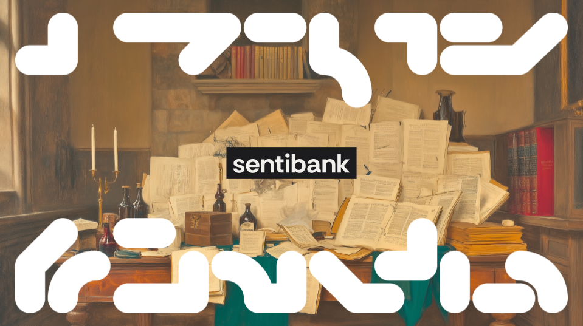

<div align="center">
  

  [![socius](https://img.shields.io/badge/Lab-socius-00002E?logo=data:image/svg%2bxml;base64,PHN2ZyB3aWR0aD0iMzAwIiBoZWlnaHQ9IjMwMCIgdmlld0JveD0iMCAwIDMwMCAzMDAiIGZpbGw9Im5vbmUiIHhtbG5zPSJodHRwOi8vd3d3LnczLm9yZy8yMDAwL3N2ZyI+CjxwYXRoIGZpbGwtcnVsZT0iZXZlbm9kZCIgY2xpcC1ydWxlPSJldmVub2RkIiBkPSJNMTkxIDQyQzE5MSAzNC44MjAzIDE5Ni44MiAyOSAyMDQgMjlMMjU4IDI5QzI2NS4xOCAyOSAyNzEgMzQuODIwMyAyNzEgNDJDMjcxIDQ5LjE3OTcgMjY1LjE4IDU1IDI1OCA1NUwyMDQgNTVDMTk2LjgyIDU1IDE5MSA0OS4xNzk3IDE5MSA0MloiIGZpbGw9IiNGMUYwRUMiLz4KPHBhdGggZmlsbC1ydWxlPSJldmVub2RkIiBjbGlwLXJ1bGU9ImV2ZW5vZGQiIGQ9Ik00MiAxMDlDMzQuODIwMyAxMDkgMjkgMTAzLjE4IDI5IDk2TDI5IDQyQzI5IDM0LjgyMDMgMzQuODIwMyAyOSA0MiAyOUM0OS4xNzk3IDI5IDU1IDM0LjgyMDMgNTUgNDJMNTUgOTZDNTUgMTAzLjE4IDQ5LjE3OTcgMTA5IDQyIDEwOVoiIGZpbGw9IiNGMUYwRUMiLz4KPHBhdGggZmlsbC1ydWxlPSJldmVub2RkIiBjbGlwLXJ1bGU9ImV2ZW5vZGQiIGQ9Ik0yNTggMTkxQzI2NS4xOCAxOTEgMjcxIDE5Ni44MiAyNzEgMjA0TDI3MSAyNThDMjcxIDI2NS4xOCAyNjUuMTggMjcxIDI1OCAyNzFDMjUwLjgyIDI3MSAyNDUgMjY1LjE4IDI0NSAyNThMMjQ1IDIwNEMyNDUgMTk2LjgyIDI1MC44MiAxOTEgMjU4IDE5MVoiIGZpbGw9IiNGMUYwRUMiLz4KPHBhdGggZmlsbC1ydWxlPSJldmVub2RkIiBjbGlwLXJ1bGU9ImV2ZW5vZGQiIGQ9Ik0xMDkgMjU4QzEwOSAyNjUuMTggMTAzLjE4IDI3MSA5NiAyNzFMNDIgMjcxQzM0LjgyMDMgMjcxIDI5IDI2NS4xOCAyOSAyNThDMjkgMjUwLjgyIDM0LjgyMDMgMjQ1IDQyIDI0NUw5NiAyNDVDMTAzLjE4IDI0NSAxMDkgMjUwLjgyIDEwOSAyNThaIiBmaWxsPSIjRjFGMEVDIi8+CjxwYXRoIGZpbGwtcnVsZT0iZXZlbm9kZCIgY2xpcC1ydWxlPSJldmVub2RkIiBkPSJNMjkgOTZDMjkgODguODIwMyAzNC44MjAzIDgzIDQyIDgzTDk2IDgzQzEwMy4xOCA4MyAxMDkgODguODIwMyAxMDkgOTZDMTA5IDEwMy4xOCAxMDMuMTggMTA5IDk2IDEwOUw0MiAxMDlDMzQuODIwMyAxMDkgMjkgMTAzLjE4IDI5IDk2WiIgZmlsbD0iI0YxRjBFQyIvPgo8cGF0aCBmaWxsLXJ1bGU9ImV2ZW5vZGQiIGNsaXAtcnVsZT0iZXZlbm9kZCIgZD0iTTIwNCA4M0MyMTEuMTggODMgMjE3IDg4LjgyMDMgMjE3IDk2TDIxNyAxNTBDMjE3IDE1Ny4xOCAyMTEuMTggMTYzIDIwNCAxNjNDMTk2LjgyIDE2MyAxOTEgMTU3LjE4IDE5MSAxNTBMMTkxIDk2QzE5MSA4OC44MjAzIDE5Ni44MiA4MyAyMDQgODNaIiBmaWxsPSIjRjFGMEVDIi8+CjxwYXRoIGZpbGwtcnVsZT0iZXZlbm9kZCIgY2xpcC1ydWxlPSJldmVub2RkIiBkPSJNMjcxIDIwNEMyNzEgMjExLjE4IDI2NS4xOCAyMTcgMjU4IDIxN0wyMDQgMjE3QzE5Ni44MiAyMTcgMTkxIDIxMS4xOCAxOTEgMjA0QzE5MSAxOTYuODIgMTk2LjgyIDE5MSAyMDQgMTkxTDI1OCAxOTFDMjY1LjE4IDE5MSAyNzEgMTk2LjgyIDI3MSAyMDRaIiBmaWxsPSIjRjFGMEVDIi8+CjxwYXRoIGZpbGwtcnVsZT0iZXZlbm9kZCIgY2xpcC1ydWxlPSJldmVub2RkIiBkPSJNOTYgMjE3Qzg4LjgyMDMgMjE3IDgzIDIxMS4xOCA4MyAyMDRMODMgMTUwQzgzIDE0Mi44MiA4OC44MjAzIDEzNyA5NiAxMzdDMTAzLjE4IDEzNyAxMDkgMTQyLjgyIDEwOSAxNTBMMTA5IDIwNEMxMDkgMjExLjE4IDEwMy4xOCAyMTcgOTYgMjE3WiIgZmlsbD0iI0YxRjBFQyIvPgo8cGF0aCBmaWxsLXJ1bGU9ImV2ZW5vZGQiIGNsaXAtcnVsZT0iZXZlbm9kZCIgZD0iTTI1OCA4M0MyNjUuMTggODMgMjcxIDg4LjgyMDMgMjcxIDk2QzI3MSAxMzMuMDAyIDI0MS4wMDIgMTYzIDIwNCAxNjNDMTk2LjgyIDE2MyAxOTEgMTU3LjE4IDE5MSAxNTBDMTkxIDE0Mi44MiAxOTYuODIgMTM3IDIwNCAxMzdDMjI2LjY0MiAxMzcgMjQ1IDExOC42NDIgMjQ1IDk2QzI0NSA4OC44MjAzIDI1MC44MiA4MyAyNTggODNaIiBmaWxsPSIjRjFGMEVDIi8+CjxwYXRoIGZpbGwtcnVsZT0iZXZlbm9kZCIgY2xpcC1ydWxlPSJldmVub2RkIiBkPSJNODMgNDJDODMgMzQuODIwMyA4OC44MjAzIDI5IDk2IDI5QzEzMy4wMDIgMjkgMTYzIDU4Ljk5ODEgMTYzIDk2QzE2MyAxMDMuMTggMTU3LjE4IDEwOSAxNTAgMTA5QzE0Mi44MiAxMDkgMTM3IDEwMy4xOCAxMzcgOTZDMTM3IDczLjM1NzUgMTE4LjY0MiA1NSA5NiA1NUM4OC44MjAzIDU1IDgzIDQ5LjE3OTcgODMgNDJaIiBmaWxsPSIjRjFGMEVDIi8+CjxwYXRoIGZpbGwtcnVsZT0iZXZlbm9kZCIgY2xpcC1ydWxlPSJldmVub2RkIiBkPSJNMjE3IDI1OEMyMTcgMjY1LjE4IDIxMS4xOCAyNzEgMjA0IDI3MUMxNjYuOTk4IDI3MSAxMzcgMjQxLjAwMiAxMzcgMjA0QzEzNyAxOTYuODIgMTQyLjgyIDE5MSAxNTAgMTkxQzE1Ny4xOCAxOTEgMTYzIDE5Ni44MiAxNjMgMjA0QzE2MyAyMjYuNjQyIDE4MS4zNTggMjQ1IDIwNCAyNDVDMjExLjE4IDI0NSAyMTcgMjUwLjgyIDIxNyAyNThaIiBmaWxsPSIjRjFGMEVDIi8+CjxwYXRoIGZpbGwtcnVsZT0iZXZlbm9kZCIgY2xpcC1ydWxlPSJldmVub2RkIiBkPSJNNDIgMjE3QzM0LjgyMDMgMjE3IDI5IDIxMS4xOCAyOSAyMDRDMjkgMTY2Ljk5OCA1OC45OTgyIDEzNyA5NiAxMzdDMTAzLjE4IDEzNyAxMDkgMTQyLjgyIDEwOSAxNTBDMTA5IDE1Ny4xOCAxMDMuMTggMTYzIDk2IDE2M0M3My4zNTc2IDE2MyA1NSAxODEuMzU4IDU1IDIwNEM1NSAyMTEuMTggNDkuMTc5NyAyMTcgNDIgMjE3WiIgZmlsbD0iI0YxRjBFQyIvPgo8L3N2Zz4K&logoColor=white)](https://socius.org)
  [](https://doi.org/10.1609/icwsm.v18i1.31443)
  [](https://pypistats.org/packages/sentibank)
  [](https://github.com/socius-org/sentibank/actions)
  [](https://creativecommons.org/licenses/by-nc-sa/4.0/)
</div>

# sentibank

**sentibank** is an open database of expert-curated sentiment dictionaries, packaged as a Python
library. It consolidates 15 original lexicons and 43 preprocessed dictionaries, spanning 7 genres
and 6 domains, behind one loader, a bag-of-words analyser and a command-line interface. The
resource is described in [Oh (2024)](https://doi.org/10.1609/icwsm.v18i1.31443), published at
ICWSM 2024.

## TL;DR

Rule-based sentiment analysis still matters wherever a result has to be explained: policy, health,
and most of computational social science. Its raw material, the expert-curated lexicon, is scattered
across papers, personal web pages and dead links, in incompatible formats and with uneven
documentation of how each was built. sentibank collects these lexicons in one place, keeps the
original files next to preprocessed versions in a common format, and documents the provenance of
each one.

**One loader for every lexicon.** `archive.load().dict("VADER_v2014")` returns a dictionary; the same
call works for all 43 preprocessed identifiers, with caching for repeated loads.

**Originals kept alongside.** `load.origin(...)` returns the author's original file as a pandas
DataFrame, so preprocessing choices can be checked and redone.

**Documented provenance.** Every lexicon has a page in the [documentation](https://socius-org.github.io/sentibank/archive/intro.html)
covering composition, annotation methodology, evaluation and usage guidance, with references.

## Install

Python 3.10 or later.

```bash
pip install sentibank
```

The spaCy model `en_core_web_sm` is downloaded on first use if it is missing.

## Quickstart

```python
from sentibank import archive
from sentibank.utils import analyze

load = archive.load()
vader = load.dict("VADER_v2014")          # preprocessed dictionary
vader_raw = load.origin("VADER_v2014")    # original file, as a pandas DataFrame

analyzer = analyze()
analyzer.sentiment("I am excited and happy about the new announcement!", dictionary="VADER_v2014")
# 4.1
analyzer.sentiment("We are pleased to announce record results to our shareholders.", dictionary="MASTER_v2022")
# {'Negative': 0, 'Uncertainty': 0, 'Constraining': 0, 'Positive': 1, 'Litigious': 0, 'Weak_Modal': 0, 'Strong_Modal': 0}
analyzer.dictionary("WordNet-Affect_v2006")   # summary of the lexicon's structure and scores
```

`sentiment()` is a bag-of-words analysis: term order is ignored. For score-based lexicons such as
`VADER_v2014` it sums the scores of matched terms and returns one number. For label-based lexicons
such as `MASTER_v2022` or `GeneralInquirer_v2000` it counts matched terms per category and returns
those counts.

The same operations are available from the command line:

```bash
sentibank list                                                   # identifiers of every dictionary
sentibank info VADER_v2014                                       # size, type, source
sentibank analyze VADER_v2014 "This product is absolutely amazing!"
sentibank analyze AFINN_v2015 --file reviews.txt --json          # a file, machine-readable output
sentibank export MASTER_v2022 --format csv --output master.csv  # csv or json
```

Other loader methods: `list_available()` returns the identifiers of dictionaries and originals, and
`clear_cache()` drops cached dictionaries.

## Dictionaries

Identifiers follow `{NAME}_{VERSION}` when only compulsory processing was applied to the base
lexicon, and `{NAME}_{VERSION}_{refinement}` when a discretionary transformation was added. For
example, `NoVAD_v2013_boosted` applies arousal-based adjustments that intensify extreme valence
values and dampen neutral ones, giving a single richness-preserving score.

| Sentiment Dictionary | Description | Genre | Domain | Predefined Identifiers (preprocessed) |
|------------------------|---------------|------|-----|------------------------|
|**AFINN** <br> (Nielsen, 2011)| General purpose lexicon with sentiment ratings for common emotion words. |Social Media|General| `AFINN_v2009`, `AFINN_v2011`, `AFINN_v2015` |
|**Aigents+** <br> (Raheman et al., 2022)| Lexicon optimised for social media posts related to cryptocurrencies. |Social Media|Cryptocurrency| `Aigents+_v2022`|
|**ANEW** <br> (Bradley and Lang, 1999)| Provides normative emotional ratings across pleasure, arousal, and dominance dimensions.|General (standard English)|Psychology|`ANEW_v1999_simple`, `ANEW_v1999_weighted`|
|**Dictionary of Affect in Language (DAL)** <br> (Whissell, 1989; Whissell, 2009)| Lexicon designed to quantify pleasantness, activation, and imagery dimensions across diverse everyday English words. | Vernacular (Day-to-Day Expression) | General | `DAL_v2009_boosted`, `DAL_v2009_norm` |
|**Discrete Emotions Dictionary (DED)** <br> (Fioroni et al., 2022)| Lexicon focused on precisely distinguishing four key discrete emotions in political communication | News | Political Science | `DED_v2022` |
|**General Inquirer** <br> (Stone et al., 1962)| Lexicon capturing broad psycholinguistic dimensions across semantics, values and motivations.  |General (standard English)|Psychology, Political Science| `GeneralInquirer_v2000`|
|**Henry** <br> (Henry, 2006) | Lexicon designed for analysing tone in earnings press releases. |Corporate Communication (Earnings Press Releases)|Finance| `Henry_v2006`|
|**MASTER** <br> (Loughran and McDonald, 2011; Bodnaruk, Loughran and McDonald, 2015)| Financial lexicons covering expressions common in business writing. |Regulatory Filings (10-K)|Finance| `MASTER_v2022`|
|**Norms of Valence, Arousal and Dominance (NoVAD)** <br> (Warriner, Kuperman and Brysbaert, 2013; Warriner and Kuperman, 2014)| A lexicon of 14,000 common English lemmas across valence, arousal, and dominance dimensions.  | Vernacular (Day-to-Day Expression) | General, Psychology |  `NoVAD_v2013_boosted`, `NoVAD_v2013_norm`|
|**OpinionLexicon** <br> (Hu and Liu, 2004)| Opinion words tailored for sentiment analysis of product reviews.|Reviews|Consumer Products|`OpinionLexicon_v2004`|
|**SenticNet** <br> (Cambria et al., 2010; Cambria, Havasi and Hussain, 2012; Cambria, Olsher and Rajagopal, 2014; Cambria et al., 2016, 2018, 2020, 2022) | Conceptual lexicon providing multidimensional sentiment analysis for commonsense concepts and expressions. | General (standard & non-standard English) | General | `SenticNet_v2010`, `SenticNet_v2012`, `SenticNet_v2012_attributes`, `SenticNet_v2012_semantics`, `SenticNet_v2014`, `SenticNet_v2014_attributes`, `SenticNet_v2014_semantics`, `SenticNet_v2016`, `SenticNet_v2016_attributes`, `SenticNet_v2016_mood`, `SenticNet_v2016_semantics`, `SenticNet_v2018`, `SenticNet_v2018_attributes`, `SenticNet_v2018_mood`, `SenticNet_v2018_semantics`, `SenticNet_v2020`, `SenticNet_v2020_attributes`, `SenticNet_v2020_mood`, `SenticNet_v2020_semantics`, `SenticNet_v2022`, `SenticNet_v2022_attributes`, `SenticNet_v2022_mood`, `SenticNet_v2022_semantics` |
|**SentiWordNet** <br> (Esuli and Sebastiani, 2006; Baccianella, Esuli and Sebastiani, 2010)| Lexicon associating WordNet synsets with positive, negative, and objective scores. |General (standard English)|General| `SentiWordNet_v2010_logtransform`, `SentiWordNet_v2010_simple`|
| **SO-CAL** <br> (Taboada et al., 2011) | Lexicon designed for domain-independent sentiment analysis. | General (standard & non-standard English) | General | `SO-CAL_v2011` |
|**VADER** <br> (Hutto and Gilbert, 2014)| General purpose lexicon optimised for social media and microblogs. |Social Media|General| `VADER_v2014`|
|**WordNet-Affect** <br> (Strapparava and Valitutti, 2004; Valitutti, Strapparava and Stock, 2004; Strapparava, Valitutti and Stock, 2006)| Hierarchically organised affective labels providing a granular emotional dimension. |General (standard English)|Psychology| `WordNet-Affect_v2006`|

## Repository structure

```
sentibank/
  archive.py       load: dict(), origin(), json_dict(), list_available(), clear_cache()
  utils.py         analyze: dictionary(), sentiment()
  validate.py      validation of contributed lexicons
  cli.py           sentibank list / info / analyze / export
  dict_arXiv/      one folder per lexicon: original CSV plus JSON and pickle versions
docs/              Jupyter Book: getting started, one page per lexicon, contribution guide
examples/          basic usage, dictionary comparison, CLI examples
tests/             pytest suite
```

## Documentation

The [documentation](https://socius-org.github.io/sentibank/about.html) covers installation, loading and
analysis, and has a page for each lexicon with its composition, methodology, evaluation and usage
guidance.

## Contributing

New expert-curated lexicons are welcome. The [contribution criteria](.github/CONTRIBUTING.md) cover
scope, composition, methodology, licensing and format. We are also working with domain experts on
new gold-standard dictionaries for topics such as ideology, markets, cryptocurrency, politics and
ESG; researchers who want to take part can write to research@socius.org.

## Citation

```bibtex
@inproceedings{oh2024sentibank,
  title     = {sentibank: A Unified Resource of Sentiment Lexicons and Dictionaries},
  author    = {Oh, Nick},
  booktitle = {Proceedings of the International AAAI Conference on Web and Social Media},
  volume    = {18},
  pages     = {2003--2013},
  year      = {2024},
  doi       = {10.1609/icwsm.v18i1.31443}
}
```

## License

The package is released under [CC BY-NC-SA 4.0](https://creativecommons.org/licenses/by-nc-sa/4.0/).
Each lexicon keeps the license of its original authors; see [docs/licenses.txt](docs/licenses.txt).
